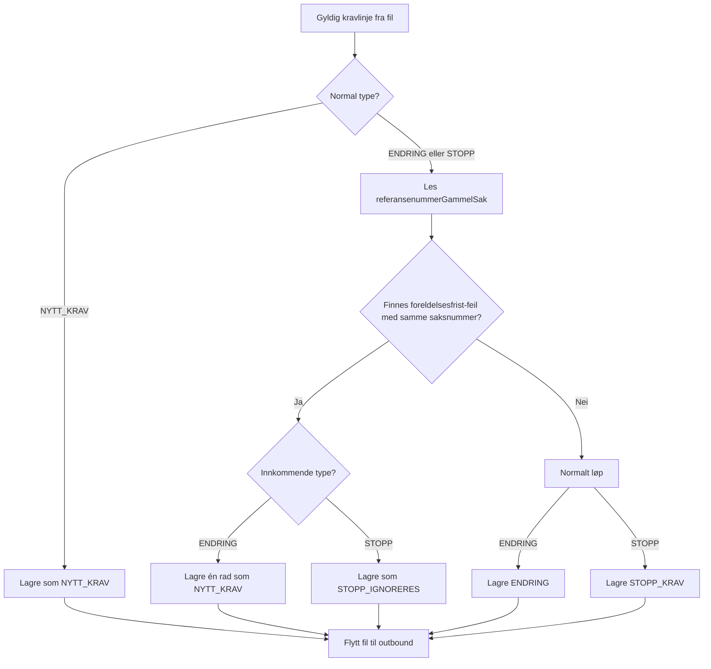
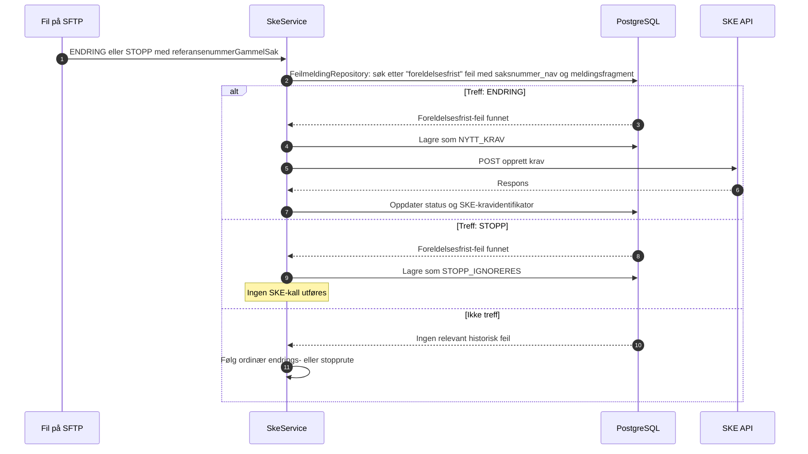

# Oppryddingsspor for foreldelsesfristens utgangspunkt

## Innhold

- [Formål](#formål)
- [Beslutningsflyt ved innlesing](#beslutningsflyt-ved-innlesing)
- [Utsending til SKE](#utsending-til-ske)
- [Avgrensning og oppslagsregel](#avgrensning-og-oppslagsregel)
- [Effekt](#effekt)
- [Observability og drift](#observability-og-drift)
- [Testdekning](#testdekning)

## Formål

Vedtaksløsningene kan sende en korrigering som `ENDRING` etter at det opprinnelige kravet ble avvist av SKE fordi `foreldelsesfristensUtgangspunkt` var for langt tilbake i tid. Korrigeringen har tilleggsfrist, men SKE kan ikke endre et krav som aldri ble opprettet. Derfor behandles denne avgrensede kategorien som et nytt krav.

En `STOPP` som direkte refererer til samme originale, avviste sak lagres med både `kravtype = STOPP_IGNORERES` og `status = IGNORERES` for sporbarhet, uavhengig av avsender. Den sendes ikke til SKE.

Hvis originalreferansen allerede er overstyrt av en oppryddings-ENDRING lagret som `NYTT_KRAV`, eller av en første OS-STOPP lagret som `STOPP_IGNORERES`, blir senere ENDRING med samme gamle referanse lagret med `kravtype = ENDRING_IGNORERES`, og alle senere STOPP med samme gamle referanse lagres med `kravtype = STOPP_IGNORERES`, uavhengig av avsender. Begge får status `IGNORERES_ETTER_OPPRYDDING`, sendes ikke til SKE og utløser Slack-varsel.

Opprydding behandles per `referansenummerGammelSak`, ikke per nytt `saksnummerNav`. Bare første gyldige oppryddings-ENDRING for en originalreferanse kan bli `NYTT_KRAV`, også når flere korreksjoner ligger i samme fil. Senere gyldige korreksjoner med samme referanse ignoreres og varsles for å hindre dobbelt gjeldsgrunnlag i SKE. Lokalt valideringsfeilede linjer beholder `VALIDERINGSFEIL_AV_LINJE_I_FIL`; de overstyrer ikke referansen, påvirker ikke første-gyldig-regelen og får bare ordinært linjevalideringsvarsel.

## Beslutningsflyt ved innlesing



Oppslaget gjøres bare for linjer som allerede er klassifisert som `ENDRING` eller `STOPP`. Vanlige nye krav slår ikke opp i `feilmelding` og påvirkes ikke av oppryddingssporet.

### Referansekjede for opprydding

Oppryddingssporet følger en referansekjede med ett opprinnelig krav, ett oppryddingskrav og senere endringer:

1. Det opprinnelige, avviste kravet har `saksnummer = A`.
2. Oppryddingskravet kommer inn som `ENDRING` med et nytt `saksnummer = B` og `referansenummerGammelSak = A`. Det lagres som `NYTT_KRAV` og sendes til SKE med `oppdragsgiversKravIdentifikator = B`.
3. En senere endring får et nytt `saksnummer = C` og `referansenummerGammelSak = B`.

Senere endringer, som C, følger ordinær endrings- eller stopprute. De er ikke oppryddingskrav fordi referansen er B, ikke den opprinnelige avviste saken A. Hvis B ikke er effektuert når C behandles, håndteres eventuelle SKE-feil gjennom tjenestens ordinære feil- og avstemmingsflyt.

STOPP i selve oppryddingsfilen som direkte refererer til originalkravet lagres med både `kravtype = STOPP_IGNORERES` og `status = IGNORERES`, og holdes utenfor sending og resend, uavhengig av avsender.

## Utsending til SKE



## Avgrensning og oppslagsregel

Ved innlesing samler `SkeService` først distinkte `referansenummerGammelSak` for linjer som normalt klassifiseres som `ENDRING` eller `STOPP`. Referansene slås deretter opp samlet mot `feilmelding.saksnummer_nav` via `FeilmeldingRepository`. Dette gir ett databaseoppslag per fil i stedet for ett oppslag per linje.

Linjen går i oppryddingssporet bare når det finnes en historisk feilmelding hvor `melding` inneholder:

```
foreldelsesfristensUtgangspunkt kan ikke være mer enn 2 år og 10 måneder tilbake i tid.
```

En linje er et oppryddingskrav bare når `referansenummerGammelSak` er saksnummeret til det opprinnelige, avviste kravet. Når oppryddings-ENDRING-en er sendt som et nytt krav, refererer senere ENDRING-er og STOPP-er til det nye saksnummeret og følger derfor ordinær flyt uten å slå opp den opprinnelige feilen.

## Effekt

| Innkommende type | Treff i historisk feilmelding | Resultat |
| --- | --- | --- |
| ENDRING | Ja | Én rad med `kravtype = NYTT_KRAV`; sendes via opprett-krav-endepunktet. |
| Første STOPP med direkte referanse til originalen | Ja | Lagres med både `kravtype = STOPP_IGNORERES` og `status = IGNORERES`, uavhengig av avsender; ingen utsending til SKE. |
| Senere ENDRING med samme direkte referanse til originalen | Ja | Lagres med `kravtype = ENDRING_IGNORERES` og `status = IGNORERES_ETTER_OPPRYDDING`; ingen utsending til SKE og Slack-varsel. |
| Senere STOPP med samme direkte referanse til originalen | Ja | Lagres med `kravtype = STOPP_IGNORERES` og `status = IGNORERES_ETTER_OPPRYDDING`, uavhengig av avsender; ingen utsending til SKE og Slack-varsel. |
| Lokalt ugyldig ENDRING eller STOPP | Uansett | Beholder `VALIDERINGSFEIL_AV_LINJE_I_FIL`, påvirker ikke oppryddingssporet og varsles bare som linjevalideringsfeil. |
| ENDRING eller STOPP | Nei | Normal flyt er uendret. |
| NYTT_KRAV | Ikke vurdert | Normal flyt er uendret. |

## Observability og drift

`SkeService` beregner oppryddingsreferansene ved å bruke `FeilmeldingRepository` før krav og linjevalideringsfeil lagres i samme transaksjon. Det skrives kun aggregert ordinær logg uten saksnummer eller andre personopplysninger. En ignorert oppryddings-`STOPP` er synlig i `krav` med typen `STOPP_IGNORERES`, men gir ikke SKE-kall.

Slack skiller mellom `ENDRING etter overstyrt opprydding` og `STOPP etter overstyrt opprydding`. Hvert varsel inneholder både nytt `saksnummerNav` og originalt `referansenummerGammelSak`.

Sporet er avgrenset til det eksakte meldingsfragmentet over. Hvis SKE endrer feilmeldingsteksten, vil kravene følge ordinær flyt til oppslagsregelen oppdateres.

## Testdekning

Database-fixturen [`OppryddingForeldelsesfrist.sql`](../src/test/resources/SQLscript/feilmeldinger/OppryddingForeldelsesfrist.sql) inneholder både relevante foreldelsesfrist-feil og en nærliggende, men ikke-matchet feilmelding.

Testene verifiserer:

- oppslag med treff, ikke-treff og ukjent saksnummer
- ENDRING som lagres som én `NYTT_KRAV`
- første STOPP fra alle avsendere som lagres med `kravtype = STOPP_IGNORERES` uten utsending til SKE
- senere STOPP fra alle avsendere som lagres med `STOPP_IGNORERES` og `IGNORERES_ETTER_OPPRYDDING`
- ENDRING med samme direkte referanse til originalen etter en tidligere oppryddings-overstyring lagres med `ENDRING_IGNORERES` og `IGNORERES_ETTER_OPPRYDDING`
- gjentatt STOPP fra `OB04` med samme referanse til originalen lagres med `IGNORERES_ETTER_OPPRYDDING` og gir ett Slack-varsel
- bare første gyldige oppryddings-ENDRING med samme originalreferanse i én fil opprettes; senere gyldige korreksjoner ignoreres og varsles
- en lokalt ugyldig oppryddingskorreksjon overstyrer ikke originalreferansen, og får ikke et ekstra oppryddingsvarsel
- en gyldig erstatningskorreksjon etter en tidligere lokalt ugyldig oppryddingsrad opprettes og sendes som `NYTT_KRAV`
- SFTP-innlesing og utsending av oppryddings-ENDRING via opprett-krav-ruten
- at øvrige ENDRING-er i samme fil fortsatt bruker ordinær endringsrute
- at en senere `ENDRING` med referanse til oppryddingskravets nye saksnummer lagres som `ENDRING_HOVEDSTOL` og `ENDRING_RENTE`, og at en senere `STOPP` lagres og sendes som `STOPP_KRAV`
- at senere endringer følger ordinær endrings- og stopprute
