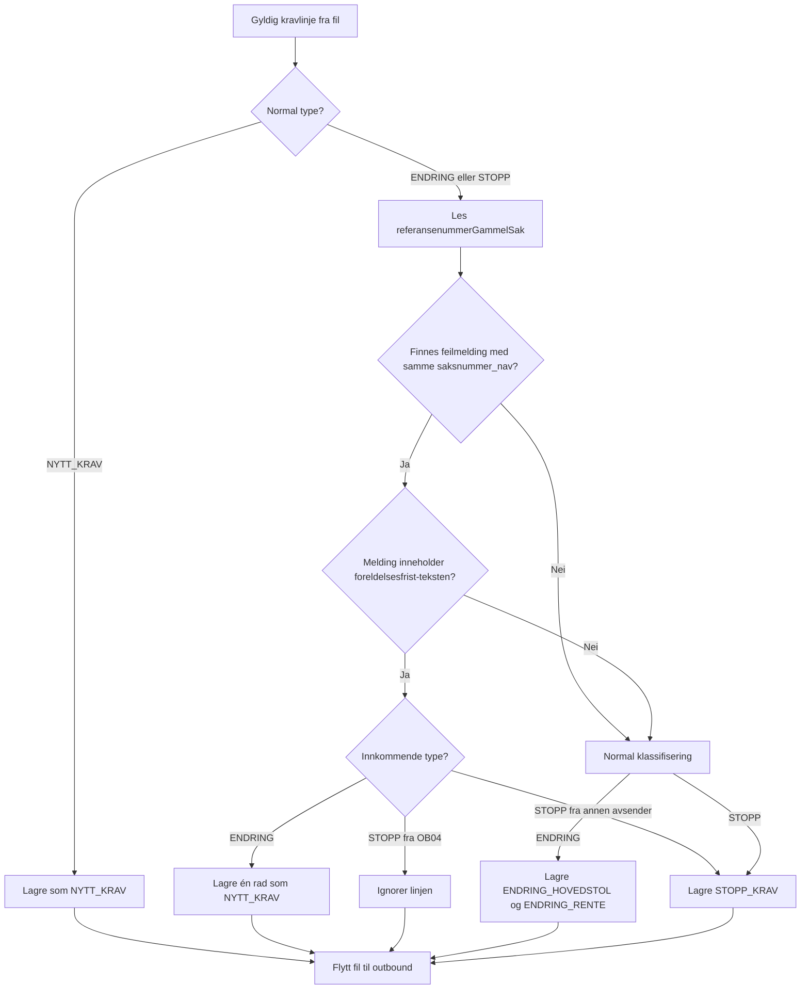
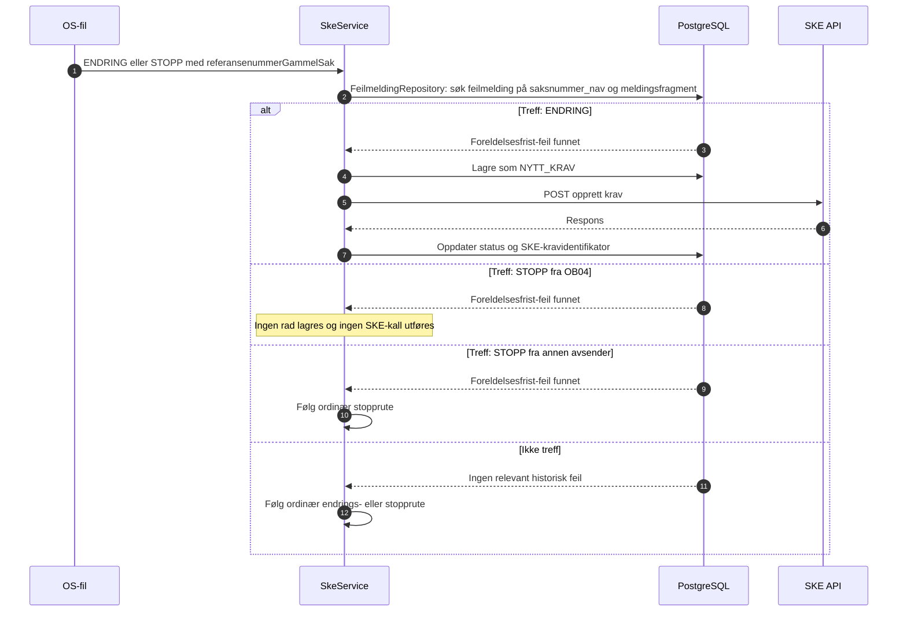

# Oppryddingsspor for foreldelsesfristens utgangspunkt

## Innhold

- [Formål](#formål)
- [Beslutningsflyt ved innlesing](#beslutningsflyt-ved-innlesing)
- [Utsending til SKE](#utsending-til-ske)
- [Avgrensning og oppslagsregel](#avgrensning-og-oppslagsregel)
- [Effekt](#effekt)
- [Observability og drift](#observability-og-drift)
- [Testdekning](#testdekning)

## Formål

Vedtaksløsningene kan sende en korrigering som `ENDRING` etter at det opprinnelige kravet ble avvist av SKE fordi `foreldelsesfristensUtgangspunkt` var for langt tilbake i tid. Korrigeringen har tilleggsfrist, men SKE kan ikke endre et krav som aldri ble opprettet. Derfor behandles denne avgrensede kategorien som et nytt krav.

OS (`avsender = OB04`) kan samtidig sende en `STOPP` (nullperiode) for samme sak. Bare denne OS-stoppen skal ikke lagres eller sendes til SKE. `STOPP` fra andre avsendere følger ordinær flyt, også når det finnes en historisk foreldelsesfrist-feil.

## Beslutningsflyt ved innlesing



Oppslaget gjøres bare for linjer som allerede er klassifisert som `ENDRING` eller `STOPP`. Vanlige nye krav slår ikke opp i `feilmelding` og påvirkes ikke av oppryddingssporet.

## Utsending til SKE



## Avgrensning og oppslagsregel

Ved innlesing beregner `SkeService` oppryddingsreferansene for linjer som normalt klassifiseres som `ENDRING` eller `STOPP`. For hver slik linje brukes `referansenummerGammelSak` som oppslag mot `feilmelding.saksnummer_nav` via `FeilmeldingRepository`.

Linjen går i oppryddingssporet bare når det finnes en historisk feilmelding hvor `melding` inneholder:

```
foreldelsesfristensUtgangspunkt kan ikke være mer enn 2 år og 10 måneder tilbake i tid.
```

## Effekt

| Innkommende type | Treff i historisk feilmelding | Resultat |
| --- | --- | --- |
| ENDRING | Ja | Én rad med `kravtype = NYTT_KRAV`; sendes via opprett-krav-endepunktet. |
| STOPP fra `OB04` | Ja | Ignoreres; ingen database-rad og ingen utsending til SKE. |
| STOPP fra annen avsender | Ja | Lagres og sendes som ordinær `STOPP_KRAV`. |
| ENDRING eller STOPP | Nei | Normal flyt er uendret. |
| NYTT_KRAV | Ikke vurdert | Normal flyt er uendret. |

## Observability og drift

`SkeService` beregner oppryddingsreferansene ved å bruke `FeilmeldingRepository`. `KravRepository` bruker deretter det ferdige settet når krav og linjevalideringsfeil lagres i én transaksjon. Det skrives kun aggregert ordinær logg uten saksnummer eller andre personopplysninger. En ignorert oppryddings-`STOPP` fra `OB04` er derfor ikke synlig som krav, feilmelding eller SKE-kall; dette er forventet oppførsel.

Sporet er avgrenset til det eksakte meldingsfragmentet over. Hvis SKE endrer feilmeldingsteksten, vil kravene følge ordinær flyt til oppslagsregelen oppdateres.

## Testdekning

Database-fixturen [`OppryddingForeldelsesfrist.sql`](../src/test/resources/SQLscript/feilmeldinger/OppryddingForeldelsesfrist.sql) inneholder både relevante foreldelsesfrist-feil og en nærliggende, men ikke-matchet feilmelding.

Testene verifiserer:

- oppslag med treff, ikke-treff og ukjent saksnummer
- ENDRING som lagres som én `NYTT_KRAV`
- STOPP fra `OB04` som ikke lagres
- STOPP fra andre avsendere som lagres som ordinær `STOPP_KRAV`
- SFTP-innlesing og utsending av oppryddings-ENDRING via opprett-krav-ruten
- at øvrige ENDRING-er i samme fil fortsatt bruker ordinær endringsrute
